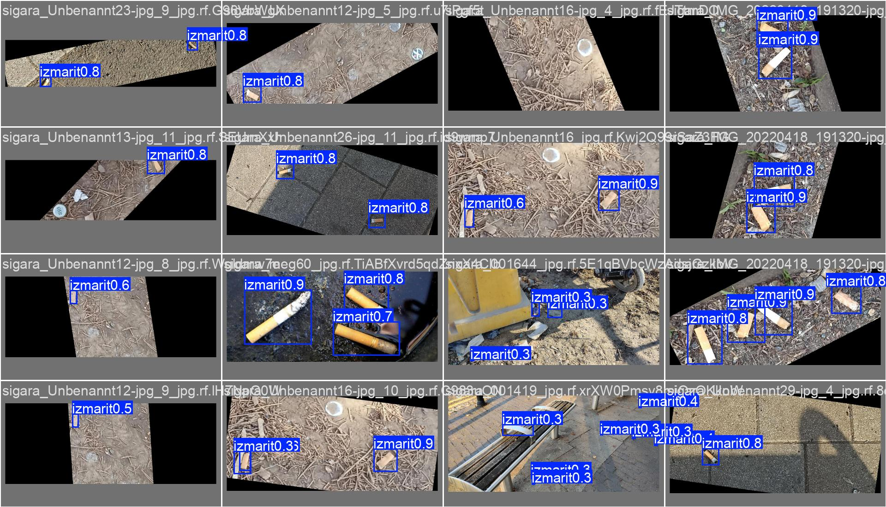

# İHA Destekli Orman Yangını Risk Tespiti



TÜBİTAK 2209-A kapsamında geliştirilen, insansız hava aracı görüntülerinden orman yangını risk faktörlerini tespit eden YOLOv8 tabanlı nesne tespit modeli.

Model üç sınıfı tespit eder: **izmarit**, **cam kırığı** ve **duman**. İlk iki sınıf yangın başlamadan önceki risk faktörlerini, duman ise başlamış bir yangının erken işaretini temsil eder.

---

## Sonuçlar

| Sınıf | Precision | Recall | mAP50 | mAP50-95 |
|---|---|---|---|---|
| **Genel** | **0.869** | **0.735** | **0.809** | **0.500** |
| cam_kirigi | 0.853 | 0.935 | 0.956 | 0.629 |
| duman | 0.908 | 0.802 | 0.906 | 0.555 |
| izmarit | 0.846 | 0.468 | 0.565 | 0.315 |

Çıkarım hızı: görüntü başına 4.6 ms (Tesla T4).

Eğitim süreci grafikleri, confusion matrix ve PR/F1 eğrileri `results/` klasöründedir.

### Sınıf bazlı değerlendirme

Cam kırığı ve duman sınıflarında yüksek başarı elde edilirken, **izmarit sınıfında recall düşük kalmıştır (0.468)**. Bunun temel nedeni ölçek farkıdır: izmarit, İHA yüksekliğinden çekilen 640×640 görüntülerde yalnızca birkaç piksellik bir alan kaplar ve küçük nesne tespiti YOLO mimarilerinin bilinen zorluk alanlarından biridir. Duman ise görüntüde geniş ve belirgin bir alan kapladığı için en yüksek precision değerine (0.908) ulaşmıştır.

İzmarit performansını artırmak için değerlendirilebilecek yaklaşımlar: daha yüksek giriş çözünürlüğü (imgsz 1280), görüntü parçalama (tiling) ile tespit, ve daha yakın mesafeden çekilmiş ek izmarit verisi toplanması.

---

## Veri Seti

Veri seti saha çekimleriyle üretilen özgün görüntülerden oluşturulmuş ve [Roboflow](https://roboflow.com) üzerinden etiketlenmiştir.

Üç sınıf başlangıçta birbirinden bağımsız üç ayrı veri seti olarak hazırlanmış, ardından tek bir veri setinde birleştirilmiştir. Birleştirme sırasında her setin etiket dosyalarındaki sınıf ID'leri yeniden haritalanmış (izmarit → 0, cam_kirigi → 1, duman → 2) ve görsel–etiket eşleşmesi farklı dosya uzantıları için doğrulanmıştır.

| | Görsel |
|---|---|
| Toplam | 6.318 |
| Train (%70) | 4.422 |
| Validation (%20) | 1.264 |
| Test (%10) | 632 |

Veri setinin kendisi boyutu nedeniyle bu repoda yer almamaktadır; yapı tanımı `data.yaml` dosyasındadır.

---

## Eğitim

| | |
|---|---|
| Model | YOLOv8s (pretrained) |
| Parametre sayısı | 11.1M |
| Epoch | 50 |
| Görüntü boyutu | 640×640 |
| Batch size | 16 |
| Optimizer | AdamW (otomatik seçim, lr=0.001429) |
| Donanım | Google Colab — Tesla T4 GPU |
| Süre | ~4.4 saat |
| Kütüphane | Ultralytics 8.4.53 / PyTorch 2.10.0 |

Eğitim, yerel donanım kısıtları ve eğitim süresi göz önünde bulundurularak bulut tabanlı GPU ortamında gerçekleştirilmiştir.

---

## Dosya Yapısı

```
├── erkenUyariSistemi.ipynb    # Veri hazırlama ve eğitim notebook'u
├── data.yaml                   # Veri seti yapı tanımı ve sınıflar
├── results/                    # Eğitim grafikleri ve değerlendirme çıktıları
└── weights/
    └── best.pt                 # Eğitilmiş model ağırlıkları
```

---

## Kullanım

```python
from ultralytics import YOLO

model = YOLO('weights/best.pt')
results = model('goruntu.jpg')
results[0].show()
```

Yeniden eğitim için notebook'taki yollar Colab ortamına göre (`/content/dataset`) yapılandırılmıştır; farklı bir ortamda çalıştırmak için `data.yaml` içindeki `path` değerinin güncellenmesi gerekir.

---

## Proje Hakkında

TÜBİTAK 2209-A Üniversite Öğrencileri Araştırma Projeleri Destekleme Programı kapsamında, iki kişilik bir ekiple yürütülmüştür. Bu repodaki çalışma; veri seti hazırlığı, model eğitimi ve değerlendirme süreçlerini kapsamaktadır.
